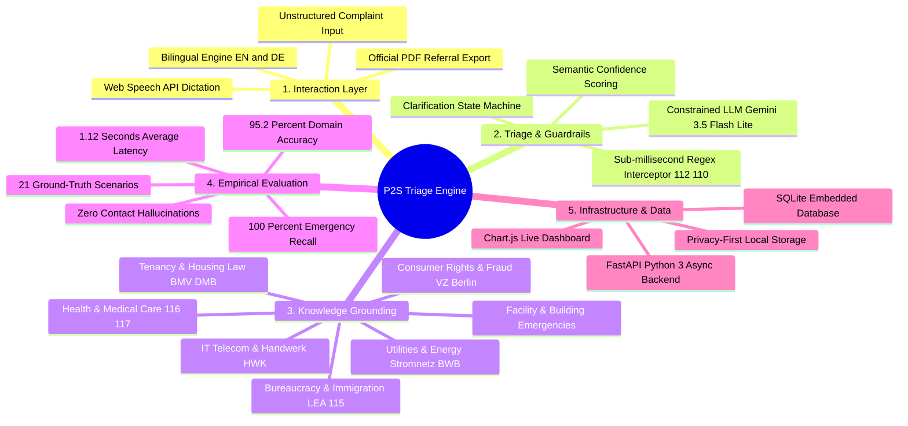

# P2S System — Architectural Mind Map

This mind map outlines the core pillars of the **P2S (Problem-to-Service)** system architecture for the MSc Computer Science Thesis.

---

## Interactive Local Mind Map
You can also view the styled interactive diagram locally by opening [`mindmap.html`](mindmap.html) in any browser, or use the **"Print / Save as PDF"** button inside it to export an executive summary sheet.
